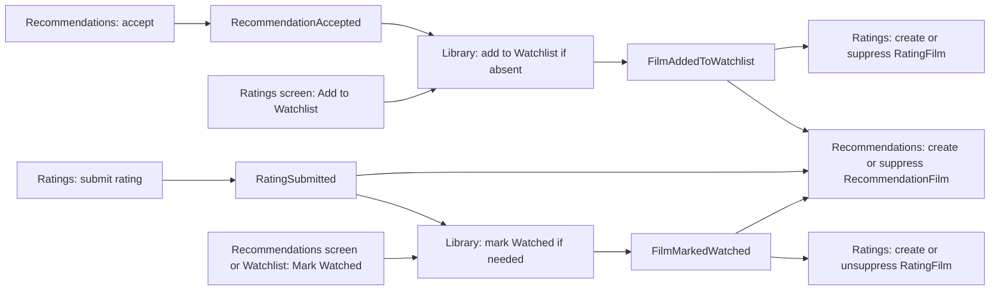
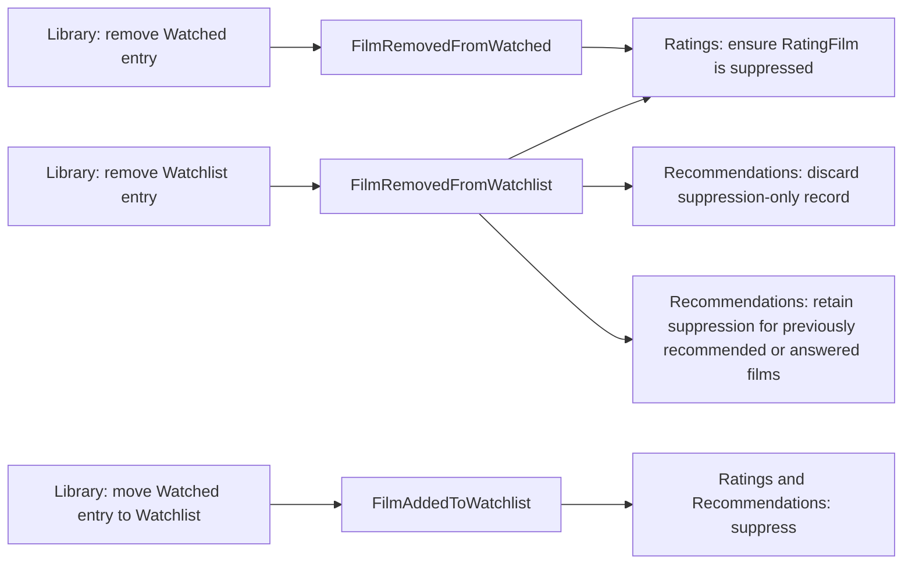

# Asynchronous domain communication

Library, Ratings and Recommendations use durable Foundation delivery for the contracts below. Preference events and accepted-quality reassessment remain future work.

## Decision and boundaries

Owner clarification, 26 October 2026: domain boundaries are ownership boundaries, not read-access barriers. All domains may read the shared database, including another domain’s models/scopes, while respecting session/user access controls. Each domain owns its mutations, invariants and lifecycle. Read-only presentation queries do not require event-derived copies or new provider/consumer tasks. Durable events remain the agreed mechanism for existing cross-domain state-changing reactions; this clarification does not replace those workflows. For example, Library derives rated/awaiting-rating display from Ratings-owned records without storing its own rated flag.

Library, Ratings and Recommendations own their data and publish domain facts through durable asynchronous delivery. The source action commits without waiting for other domains. Briefly stale screens are acceptable; lost updates, duplicate effects and stale events reversing newer state are not. A single deployed Rails application with PostgreSQL and durable background jobs is sufficient; no external message broker or separately deployed service is required.

Publish the source change and its outbox event in one database transaction. Each consumer later commits only its own domain updates and delivery receipt. The outbox is delivery infrastructure, not the authoritative domain history or an event-sourced replacement for models. Domain rules belong in their existing models/operations. Internal calls within a domain remain ordinary synchronous Ruby calls. This decision concerns asynchronous state-changing reactions, not a ban on synchronous shared-data reads, Identity resolution or external request/response APIs.

Library entries represent Watchlist or Watched. Viewers can move Watched entries back to Watchlist or remove them from Library while preserving Ratings history. Completed ratings supply viewing evidence. Add to Watchlist and Mark Watched are direct Library actions.

## Implemented publication and reactions

Events name domain facts, with minimum internal user/film identity in the payload and identity/schema/source sequence in the envelope. They do not expose Library STI classification or serialized models.

| Publisher / fact | Current reaction |
| --- | --- |
| Library: FilmMarkedWatched | Ratings admits a missing candidate or releases its suppression, preserving current ratings and explicit dismissal. |
| Library: FilmAddedToWatchlist | Ratings admits or suppresses its candidate. |
| Library: FilmRemovedFromWatchlist | Ratings ensures its candidate is suppressed, preserving ratings and dismissal. |
| Library: FilmRemovedFromWatched | Ratings ensures its candidate is suppressed, preserving ratings and dismissal. |
| Ratings: RatingSubmitted | Library creates/reconciles watched state, from a missing or Watchlist entry. Already watched is ignored. An actual transition publishes a causal FilmMarkedWatched in the same receipt transaction. |

Rating replacement preserves history and emits no revision event. A later consumer need must establish its actual meaning/payload before adding one. The Library subscriptions also handle the viewer action facts described below.

The Ratings queue is oldest-first by created_at/ID, unrated, not dismissed and not suppressed. Library watched facts do not jump the queue or clear dismissal. Explicit rating entry may bypass suppression or dismissal. There is no separate presentation/current-selection or seen/unseen-answer history.

A Library transition publishes its resulting action once. Stream identity is per user/film and survives Library row removal/recreation. See the [Library publication contract](library_event_publication.md), [Ratings publication contract](ratings_event_publication.md) and [operations](domain_event_operations.md) for exact payloads, stream identity and recovery.

## Rating and recommendation events

Each publisher records a fact about its own domain. Its state and UI are independent of any subscriber. The receiving domain treats each event as a possible transition from its current state. It applies the transition only from an allowed starting state. A valid event with no applicable transition is ignored, including when the film is unavailable. It cannot raise a domain error for a state mismatch. Investigate inconsistent data separately. Unsupported schemas and technical processing failures follow Foundation delivery handling.

| Publisher | Event | Fact | Library reaction |
| --- | --- | --- | --- |
| `ratings` | `RatingSubmitted` | The viewer submitted a rating. | Create a Watched entry or mark an existing Watchlist entry Watched. |
| `recommendations` | `RecommendationAccepted` | The viewer accepted the recommendation. | Add a Watchlist entry if there is no Library entry. |

The `RecommendationAccepted` v1 payload contains exactly the positive internal integers `user_id`, `film_id`, and `recommendation_film_id`. `RatingSubmitted` retains its existing contract. The response or rating and its event commit together. Each publisher's per-viewer, per-film stream uses `film:<internal film ID>`. The envelope supplies the event ID, source sequence, version, correlation and causation. Dismissal and rejection stay local. Add to Watchlist and Mark Watched call Library directly and do not record a rating dismissal or recommendation response.

Library reads its current state under the existing user lock. An acceptance delivered after a separate Watchlist addition and removal adds the film again if there is no entry. The owner confirmed this behavior for the initial release. It ignores duplicate or inapplicable facts, including a Watchlist addition for a Watched film. It publishes `FilmAddedToWatchlist` or `FilmMarkedWatched` only when a change occurs and propagates the source correlation and causation. Foundation records delivery receipts, retries technical failures and skips inactive owners. A receipt describes delivery of an event to a subscriber.

Recommendations sets `suppressed` on `RatingSubmitted`, `FilmMarkedWatched`, and `FilmAddedToWatchlist`. `FilmRemovedFromWatchlist` discards a suppression-only record if the film has never been recommended and has no response. Previously recommended or answered records stay suppressed. Recommendations retains existing suppression after Watched removal. Either publisher can establish the record. Suppression never records or erases a recommendation response. Repeated facts without an applicable change are ignored, including removal with no suppression-only record to discard.

Use one ordered subscription per publisher and receiving domain. Ratings and Library streams have no guaranteed relative delivery order. Watchlist events are ordered within the Library stream. Cross-publisher ordering is deferred. A removal delivered after a rating can discard a suppression-only record until the derived Watched event arrives. The coordinated development rebuild starts with empty activity, streams and receipts. The subscriptions catch up from retained supported events using Foundation delivery. Unsupported versions fail explicitly.

## Domain event flows

### Entering Watchlist or Watched

Ratings offers the oldest eligible candidate after delivery. Eligibility requires an unrated, unsuppressed and undismissed candidate. Dismiss and Reject are local actions.

### Leaving Watchlist or Watched

Ratings preserves ratings and explicit dismissal. A Library action publishes its event only when it changes the entry. Each subscriber writes only its own state.

## Delivery contract and failure handling

- Envelope: unique event ID, event name/schema version, owning domain, durable stream identity, monotonic stream sequence, occurred_at, correlation/causation IDs, and minimum necessary payload. No credentials, email, raw expression text or serialized Active Record objects.
- Publisher identifiers are stable constants owned by each publishing domain (for example, `Library::Events::PUBLISHING_DOMAIN`). Foundation validates presence and storage identity constraints, without a product-domain allowlist or registration step.
- Each publisher contract defines its stream granularity and ordering needs. Library uses user/film streams; user-wide preferences may require a user-level stream. Each subscriber contract defines supported historical schema versions and explicit handling of unsupported versions before implementation.
- A Library stream is per user/film, not per deletable LibraryFilm row. Sequence continuity must survive removal/recreation. Allocate versions atomically with the user-locked source write; specify persistent stream/version storage in the publisher contract.
- At-least-once delivery with independent receipts per subscriber. Domain update and unique subscriber/event receipt commit together; retry after a worker crash cannot duplicate domain effects. Source rollback leaves no deliverable event. Enqueue failure after source commit is recovered by polling the durable outbox.
- Process each subscriber's stream in order. Retry/backoff a failed predecessor without silently advancing dependent events; unrelated users/films and subscribers continue. Monitor backlog age, retries and terminal failures, and provide an explicit retry/replay procedure. Workers running in the same app do not eliminate this requirement.
- `EventDelivery` owns when a receipt is due, counts attempts, and records completion or failure. The delivery coordinator owns the locks and handler transaction. A handler failure rolls back subscriber writes before the receipt records the retry or terminal failure. Skipping an inactive owner does not count as an attempt.
- Cross-domain streams have no total order. Use source-specific versions, causal links and the conflict rules above; do not compare unrelated sequence numbers or trust timestamps to resolve races.
- Persist events even when a planned subscriber does not yet exist. Each new subscriber needs a defined bootstrap: retained events from a recorded cursor, or an owner-provided snapshot plus subsequent versions with no gap. Future subscribers must define how they consume retained events.
- Event retention/compaction must account for registered and future consumers, replay needs and privacy. Do not purge unacknowledged events simply because the initial subscriber finished. Avoid promising indefinite history retention; agree concrete policy before runtime implementation.
- Handlers lock/recheck the user before activity writes. Expired/deleted/missing owners must not be recreated by delayed events. Record a terminal skipped outcome where safe, and clean up user-owned payloads/receipts under the approved retention policy. Guest claim preserves the user ID. Infrastructure retention ownership must be decided without introducing Identity callbacks mechanically.
- No direct publisher-to-consumer synchronous fallback during outages. Show locally committed results and allow other views to converge. Receiving domains own their delivery handling.

## Handler organisation

Production reactions use `ReceivingDomain::EventHandlers::PublishingDomain::EventName`. Keep a single ordered subscription for related reactions whose order matters. Each receiving domain uses a consumer per publishing domain, such as `Library::EventHandlers::ConsumeRatingsEvent`, for validation and dispatch. Collection lookups live with Library collection management. Handlers mutate only the receiving domain through its model actions/permissions. Use explicit top-level publisher constants where nested namespaces would shadow them.

## Future contracts

Define event meaning/payload, ordering, bootstrap/delivery, duplicate/failure handling and retention before adding preference updates, accepted film-quality reassessment. Source refresh alone changes no accepted associations or user scores. Publish only when a concrete receiving-domain reaction exists; no generic workflow engine or synchronous fallback is implied.
