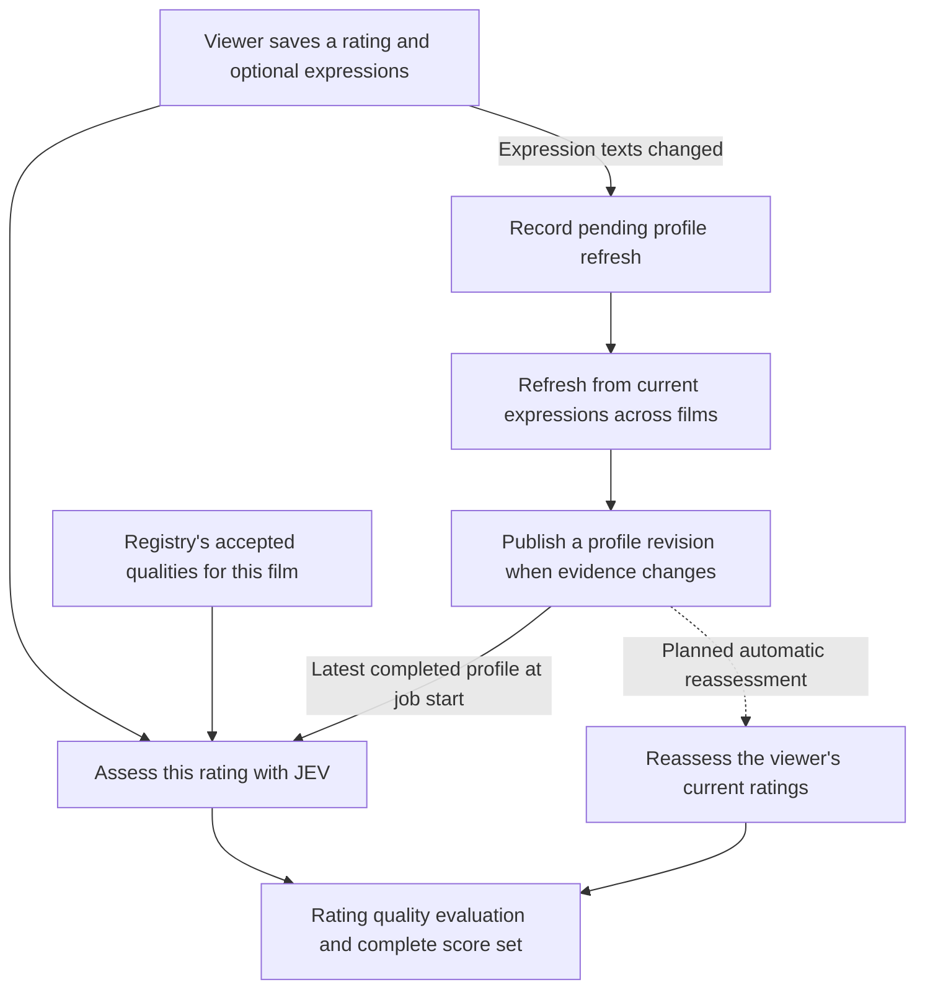
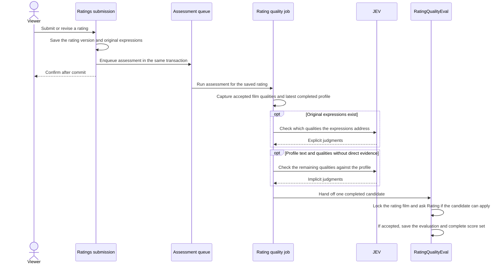
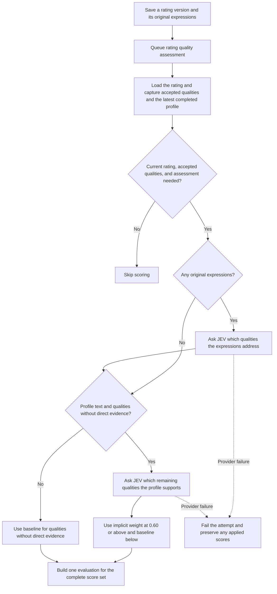
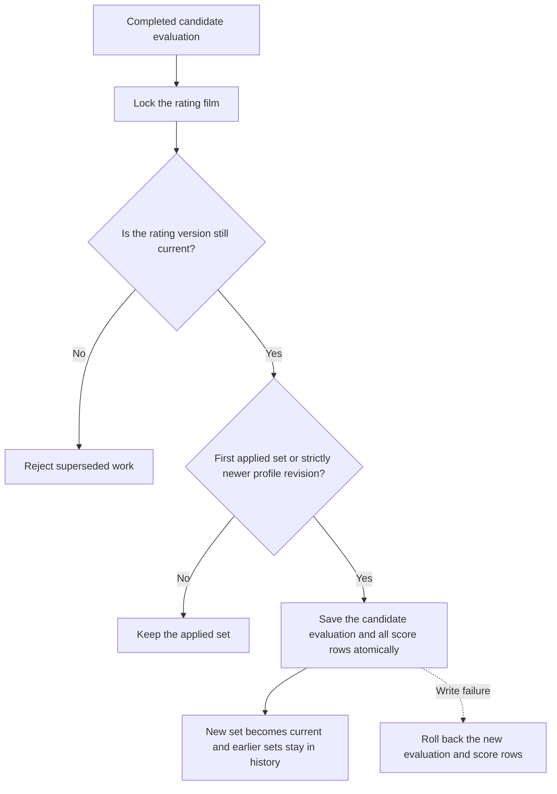
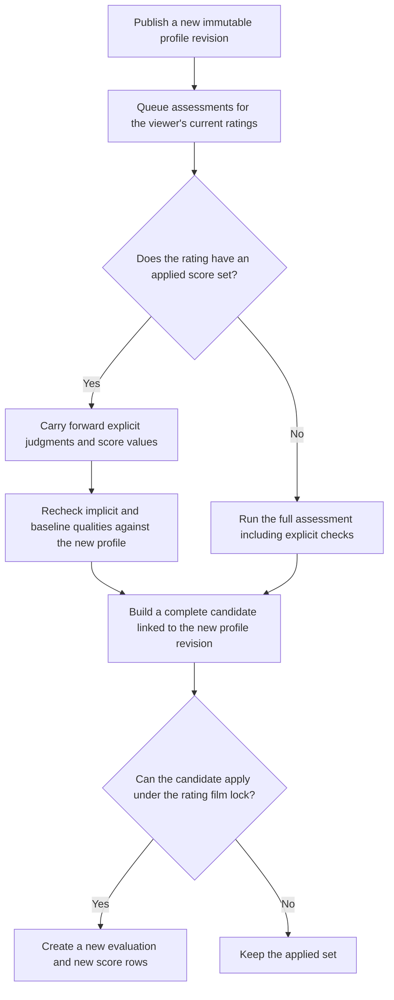
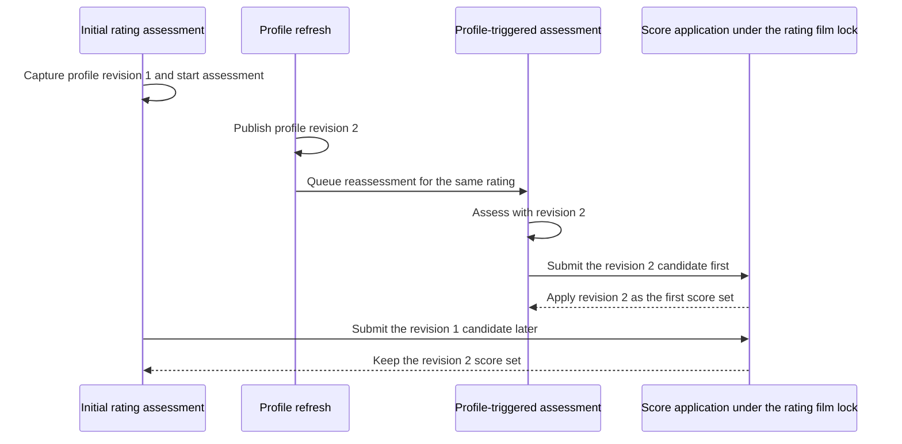

# Ratings scoring design

Status: Initial explicit, implicit and baseline scoring is ready for review. Profile refresh can be run manually. Hourly scheduling and automatic reassessment are planned.  
Owner: Ratings  
Decision dates: 22, 27 and 28 October 2026

This records the agreed scoring direction; original-expression capture is already implemented. It supersedes earlier brief terminology about separate implicit/explicit scores and mandatory pre-submission profile capture. It does not authorize scoring implementation or prescribe processing infrastructure.

## How the pieces fit together

Saving a rating starts two paths. The scoring job assesses that film using the profile already available. When the viewer changes their original expressions, a separate refresh can use their expression history to update the profile for future assessments.

The arrow from the profile revision to scoring supplies an input. The rating job can start while a profile refresh is pending. The refresh uses an LLM to synthesize the viewer's relationship with horror. JEV judges whether expressions or that profile apply to a film quality. Ratings code assigns the points.

| Record | What it represents |
| --- | --- |
| `RatingFilm` | The viewer's relationship to one film. It groups their submitted rating versions. |
| `Rating` and `RatingExpression` | One submitted rating value and the viewer's original comments for that version. |
| `ExpressionProfileRevision` | An immutable snapshot of the viewer's relationship with horror. It links to a synthesis evaluation that records the source expressions. |
| `RatingQualityEval` | The audit record for scoring one rating version. It captures the quality definitions, JEV judgments, and profile revision used. |
| `RatingQuality` | The applied classification and points for one quality. All rows in a score set link to the same evaluation. |

Read [Rating quality assessment](#rating-quality-assessment) for how a rating becomes scores, and [Expression profile and recomputation](#expression-profile-and-recomputation) for how later profile revisions affect them.

## Evidence classifications

Classification applies to a rating quality, not to the shared quality globally.

| Classification | Evidence | Association |
| --- | --- | --- |
| Unexpressed | The overall rating supplies the evidence; no applicable expression or profile interpretation. | Rating and quality; no rating expression. |
| Implicitly expressed | The user's current expression profile provides applicable evidence, without a direct expression for this rating quality. | Rating and quality; interpreted using the current expression profile, with no rating expression. |
| Explicitly expressed | An expression attached to this rating directly addresses the quality. | Rating, quality and supporting rating expressions. |

Classification identifies the source of evidence. For the initial release, applicable expressions follow the direction of the overall rating. Explicit evidence takes precedence over profile interpretation, and the overall rating supplies the baseline for qualities without applicable interpreted evidence.

| Rating | Unexpressed | Implicitly expressed | Explicitly expressed |
| --- | ---: | ---: | ---: |
| Brilliant | +2 | +4 | +5 |
| Pretty Good | +1 | +2 | +3 |
| Not For Me | −1 | −2 | −3 |
| Garbage | −2 | −4 | −5 |

## Rating quality assessment

After a rating is submitted or revised, the assessment job uses the latest completed expression profile available when it starts. Each applicable quality gets the weight for its evidence classification and the overall rating value.

### From submission to applied scores

### Choosing explicit, implicit, or baseline scores

### Applying a score set

`Rating` decides whether the candidate evaluation can apply. The evaluation records the evidence and creates the new `RatingQuality` rows in one transaction. Each row keeps its original evaluation link.

## Expression profile and recomputation

The expression profile derives exclusively from explicit expressions. Rating values, derived quality scores and profile-informed inferences must never feed back into it as user statements. Record pending profile work when a viewer submits or revises a rating with changed expressions. The planned hourly trigger processes these durable requests. Operators can run the same batch from Rails console. Synthesize only when their current explicit expressions differ from the evidence used for the last applied profile. Identical replacement text for the same film and changes that cancel within the window require no synthesis. Synthesize from the full current set so superseded text stops contributing. Clear the applied profile without a provider call when no evidence remains. Baseline and explicit scoring can proceed for each rating, and implicit scores catch up after a new profile is completed.

Synthesis receives the film title and stored Wikipedia paragraphs alongside the viewer's current original expressions. Film context helps resolve references. The viewer's expressions support the conclusions. The resulting profile is a coherent narrative that JEV can read as plain text. The synthesis evaluation stores an explanation and source expression IDs for each conclusion so a future viewer interface can show the evidence and link to the existing rating revision flow. Engineering uses unsupported conclusions as evaluation cases for prompt improvements.

Score each rating using the evidence available when it is evaluated. As new evidence becomes available, reevaluate affected scores so they catch up over time. Initial scoring can start as soon as the rating is saved, and the timing of provider work depends on when the product needs the scores. Use the latest completed expression profile available when processing starts. Record the profile version used. The planned trigger will queue reevaluation of all current ratings for that user. If the profile changes during initial evaluation, the affected rating still needs to be reevaluated against the newer version.

Profile changes trigger recomputation of eligible rating qualities: only unexpressed and implicitly expressed qualities. They may move between those classifications as applicability changes. Explicitly expressed qualities retain their expression provenance and are unaffected by profile-only changes. Changes to their own rating or expressions are a separate reassessment concern.

Implicitly expressed qualities are interpreted against the user's current expression profile, rather than belonging to an individual expression. This conceptual association does not require a per-quality profile foreign key or a captured pre-submission profile during raw-expression capture. Later processing must prevent stale work from replacing newer results and distinguish pending recomputation from completed current results; the minimal freshness mechanism belongs in that task's spec.

### Planned profile-triggered reassessment

Automatic dispatch after profile publication and reuse of explicit evidence are follow-up work. Invoking the assessment service against a newer profile currently runs the full assessment.

For a Brilliant rating, an explicit score of +5, an implicit score of +4, and a baseline score of +2 can become +5, +2, and +2 when the newer profile no longer supports the implicit judgment. The earlier rows stay linked to their original evaluation. The new evaluation records the source of any carried-forward explicit evidence.

### Planned sequence when the newer assessment finishes first

In this example, the newer assessment produces the full set because the initial assessment has yet to publish. If the initial set applies first, revision 2 can supersede it and the revision 1 scores remain in history.

### Consistency check before profile work

Apply the [AI model services design](ai_model_services_design.md) before implementing expression-profile synthesis or implicit scoring. Compare the proposed roles with Ratings explicit assessment and Registry initial assignment. Record intentional differences in the working task. Profile recomputation must preserve explicit evidence and prevent stale or duplicate contributions.

## Evaluation persistence

Ratings stores completed assessments as immutable RatingQualityEval snapshots tied to a rating version. When a profile revision is captured, the snapshot also records its ID, text, and the implicit assessment evidence. A snapshot contains the original expression text by ID, assessed quality definitions by ID, ordered calls with question and result pairs, and decisions that reference the captured expressions, qualities and result IDs. RatingQualityEval validates the question and result format and the references in the completed snapshot. The Ratings question template, criteria, cutoff and pair limit come from [explicit_quality_assessment.json](../app/services/ratings/explicit_quality_assessment.json). The `Ratings::RatingQualityScores` model module defines the default score weights. Ratings captures them when recording an evaluation. New evaluations apply their captured weights in the same transaction that records them. Historical scores remain stored with the evaluations that produced them. Explicit applicability uses an inclusive 0.60 threshold. Evaluations retain the actual threshold, assessment limits and non-secret provider settings alongside the questions, results and returned model. Provider adapters validate external responses before assessment results reach persistence. Each recorded assessment has its own database ID. The workflow that runs an assessment owns any retry policy.

Applying an assessment creates a complete set of RatingQuality rows linked to that evaluation. Each row carries its final score and classification. The latest applied set is current. The assessment service runs provider work before acquiring the rating-film lock. Under the lock, Ratings checks freshness, records the evaluation, and applies scores in one transaction. A candidate can apply if it is the first set or uses a strictly newer profile revision. Ratings without expressions can use implicit evidence when a profile is available. With neither evidence source, scoring uses the baseline. The planned profile-only reassessment will preserve existing explicit judgments.

Submitting or revising a rating enqueues its ID on `ratings_assessment` in the same PostgreSQL transaction. The viewer can continue once that transaction commits. GoodJob serializes queued executions per rating version. Missing or superseded versions finish without applying scores, and an already applied profile revision skips provider work. Films with no accepted qualities require no evaluation. Provider failures and interrupted executions remain visible as failed jobs without an automatic provider retry because the previous request may already have been billed. An operator can explicitly enqueue a fresh job for a still-current rating after investigating the failure and checking the budget.

The default development worker consumes only `domain_events`. Running a worker for `ratings_assessment` requires separate operational approval, including authorization to send real expressions to the provider. No existing-rating backfill is scheduled.

Expression-profile synthesis/updates require an LLM call, with no assumed JEV gate. JEV handles quality judgments against the resulting profile and against original expressions. Durable evaluation evidence belongs in the application database. Langfuse can trace the Ratings workflow and provider generation using counts, model, usage and evaluation linkage. Expression text and provider bodies stay out of these traces. Both evaluation models record an assessment result in an immutable `output` snapshot and enforce required fields in the database. Ratings records completed assessments. Registry also records failed attempts and tracks application separately. FilmQualityEval remains separately owned by Registry; no shared product evaluation table/framework is required.

## Recommendation scoring

Aggregate the user's rating-quality points by quality. Score each eligible recommendation candidate by summing the user's points for its associated qualities. Repeated positive evidence across films raises the matching contribution; negative evidence reduces it. This is the proposed initial additive ranking model.

Owner clarification, 28 October 2026: qualities and categories have equal **base** treatment initially (category multiplier conceptually 1). There is no additional multiplier for global importance, narrative centrality, category prestige or JEV confidence. This does not replace the rating-strength and evidence-classification rules above; those describe a user's evidence and can produce different contributions. Film-source support probabilities are not preference scores.

System- or user-controlled category weighting is a possible later capability, not an implemented rule or approved control scheme. It must not introduce an assumed subgenre/theme priority now. Film-quality admission and category-specific selection ceilings remain Registry decisions; category weights cannot restore a relevant quality excluded upstream. See [current requirements](film_quality_requirements.md#equal-starting-weights-and-personal-preference).

Reprocessing must replace derived contributions, never accumulate duplicates. Repeated mentions within a rating must not automatically multiply its contribution. Only current applicable scores contribute to current preferences; late processing of superseded inputs must not restore their contributions. The timestamped lifecycle below replaces the earlier conceptual decision to rely solely on highest-ID currentness; current rating replacement derives currentness from the highest rating ID; these proposed lifecycle fields are not implemented.

Evaluate common-quality frequency and unequal numbers of film qualities before deciding on normalization. Normalization, complete weights and ranking evaluation remain future scoring work, not requirements for original-expression persistence.

## Historical ratings and quality scores

Owner decision, 27 October 2026:

- Preserve each submitted rating/review and its expressions. Replacements take effect immediately on successful submission; record `superseded_at` on the previous version and optionally `superseded_by_id`. No rating `activated_at`, draft review or user commitment step for now. Consider those later only if frequent incremental replacement demonstrates a need.
- For ratings created by submission, the version's start is its persisted submission time (currently creation time); the previous version ends at the same replacement boundary. A historical version applies when its start is at or before `t` and supersession is absent or after `t`. Do not infer currentness merely from the largest ID once explicit validity is implemented.
- Preserve generated rating-quality scores and their association with the rating version that produced them. Expression-profile changes use the replacement/history pattern to produce new derived results without overwriting historical scores or representing unchanged expressions as fresh user evidence. A system-generated replacement is not a new user endorsement. Each applied reassessment creates a new evaluation and score rows while retaining earlier sets.
- Submission time and score availability are different when processing is deferred. Recommendation computation must identify which completed score set actually applies; do not pretend newly calculated scores were available at the review's creation. Validity/provenance for completed reassessments and the policy while replacement processing is pending must be settled in that implementation spec. This does not introduce user-facing activation for reviews.
- Recommendations owns persisted recommendation qualities and their calculated score contributions, the recommendation total and scoring-rule version. Computation reads applicable rating qualities and accepted current film-quality associations; historical display uses the saved recommendation result instead of rebuilding it from those domains. Retain source-version references for provenance. New calculations must not overwrite earlier results. Registry owns acceptance of film-quality changes. An independent archive of previous film-quality sets is not required merely to explain these saved scoring results; FilmQualityEval retains Registry judgments independently of accepted associations.
- Qualities have explicit meanings/boundaries for JEV assessment. Preserve the meaning actually assessed in historical explanations through stable concept identities or the minimal required meaning revision/saved content. A mutable name/category reference alone must not silently reinterpret old scores. This does not require storing every former film-quality set.

The podcast/profile/review comparison is a consumer of these histories, not part of standalone film analysis. Use actual engine scores and explain their calculated positive/negative contributions. Comparing new expressions with the earlier expectation must not recompute that earlier expectation against the updated profile.

Currentness still uses the highest Rating ID. Submission and replacement save the rating and expressions. Applying an evaluation creates its quality scores. Existing ratings can receive scores once evaluated. Earlier superseded ratings retain their original submissions and expressions. Explicit supersession timestamps and automatic profile reassessment remain planned.

## Source refresh and accepted quality changes

Owner direction, 28 October 2026: a Wikipedia/source refresh alone does not trigger new rating-quality scoring. A deliberate change to the accepted qualities associated with a film should trigger reassessment. Score application uses the quality IDs captured in its evaluation. Reassessment delivery remains future work. Definition/meaning changes can also require affected expression-link reassessment; category-only grouping edits do not.

Ratings owns replacing its affected current derived contributions and retains prior historical score sets; Recommendations owns its saved contributions and subsequent recalculation. Preserve original rating values/expressions, avoid duplicate contributions and stale result replacement, and distinguish pending from completed outputs. Exact affected-input selection, acceptance and domain-event contracts remain for separately scoped tasks. No publisher/subscriber or scoring implementation is added by this documentation update.

Historical rating/recommendation quality records capture which qualities contributed and how. They should remain intelligible without independently reconstructing a historical film analysis or association set. Registry retains evaluation evidence separately from accepted associations; source purge and manual-edit provenance remain separately scoped in [film-quality requirements](film_quality_requirements.md#historical-score-records).

## Raw-expression capture boundary

Ratings saves original expressions atomically with the rating version, even when the film has no accepted qualities. The assessment records the IDs of the expressions that support explicit judgments. Profile synthesis reads original expressions from current rating versions across films.
